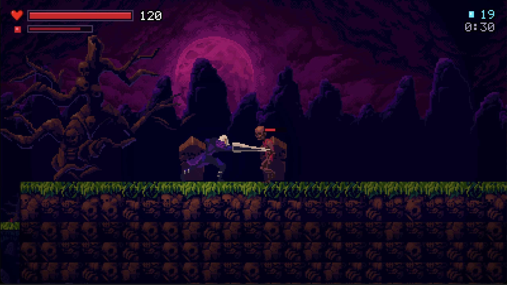
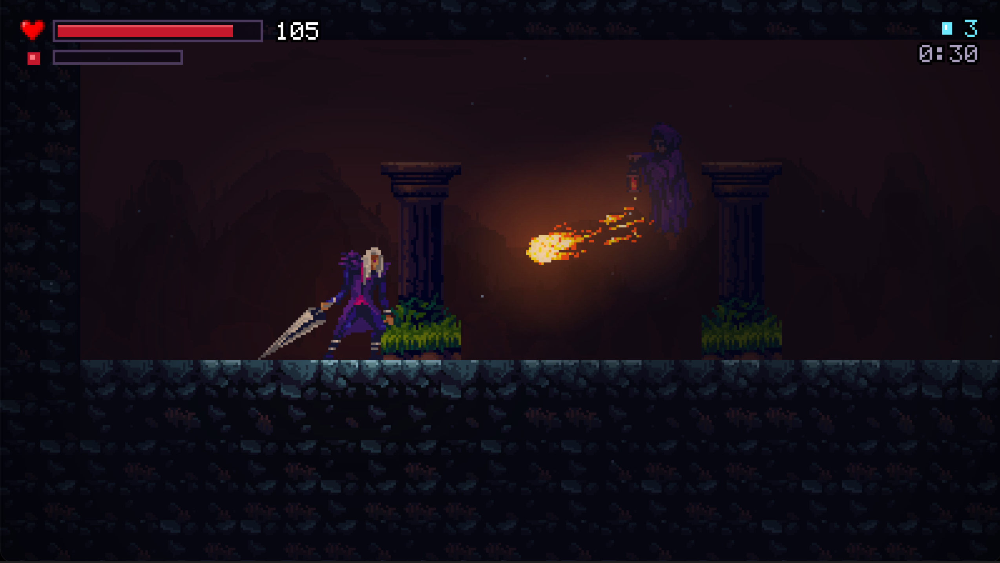
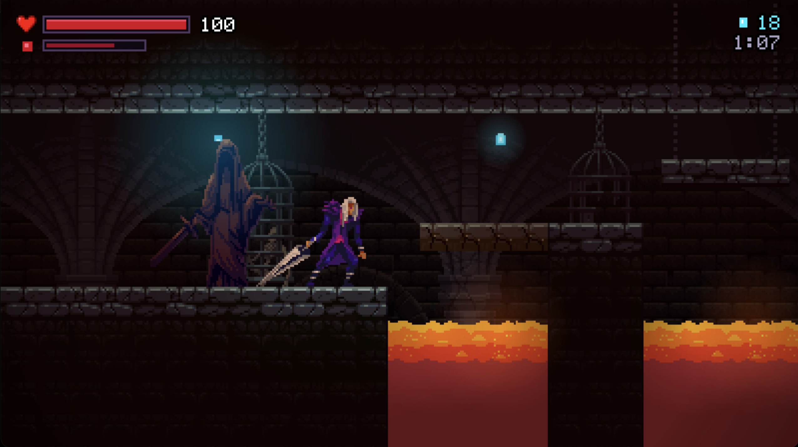
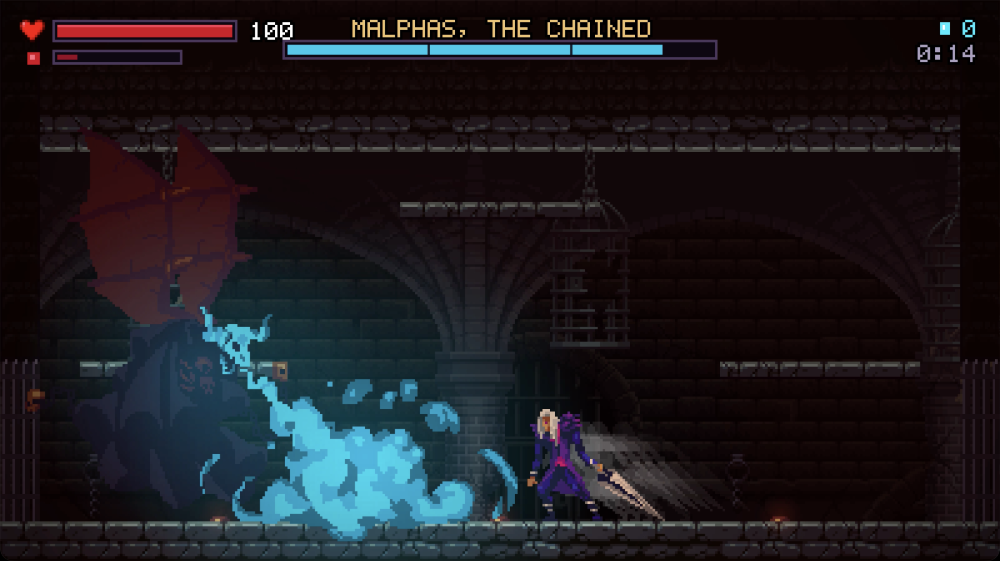

# GothicVania: Cemetery

A gothic action platformer in plain Java (Swing/Java2D, no libraries). Fight
through a cemetery, a sunken crypt and the infernal depths, then face Malphas,
the chained demon.

Originally built for my university Java coursework on City University's
CityEngine. It has since been rewritten on its own small engine, with
tile-based levels and a reworked boss.

## Screenshots

The Cemetery | The Sunken Crypt
:-------------------------:|:-------------------------:
 | 

The Infernal Depths | The Demon's Throne
:-------------------------:|:-------------------------:
 | 

## Running

Needs Java 17 or newer.

```bash
./run.sh
```

or by hand from the project root:

```bash
javac -d out $(find src -name "*.java") && java -cp out gothicvania.Main
```

## Controls

| Action | Keys |
|--------|------|
| Move | A / D or arrow keys |
| Jump (hold for higher) | Space, W or Up |
| Attack | K or J |
| Dash (invulnerable while dashing) | Shift |
| Bloodthirst special (when the meter is full) | G |
| Crouch / drop through a ledge | S, or S + jump on a ledge |
| Pause | Esc |
| Mute / fullscreen | M / F |

Jump against a wall while falling to wall-jump. Swing at a fireball to send it
back at whoever threw it.

## What's in it

- **Four chapters**: The Cemetery, The Sunken Crypt, The Infernal Depths (ending
  in a rising-lava escape) and The Demon's Throne.
- **Movement**: coyote time, jump buffering, variable jump height, mid-air dash,
  wall slide and wall-jump, one-way ledges.
- **Combat**: sword swings with hit-stop and knockback, fireball deflection,
  and a Bloodthirst meter that fills as you fight and unleashes a screen-wide
  slash.
- **Enemies**: skeletons that claw out of their graves, pouncing hell-hounds,
  lantern ghosts and blinking wraiths.
- **The boss**: a three-phase fight with readable tells. It has fireball
  volleys, a dive that leaves it stunned, flame breath, summoned skeletons,
  fire rain, and arena vents that wake in the final phase.
- **Hazards and gadgets**: spikes, lava, fire vents, moving lifts, crumbling
  blocks and cracked walls hiding secrets.
- **Progress**: checkpoints, souls, hidden hearts that raise max health,
  per-chapter results with a rank, and chapter select once unlocked. Saved in
  `~/.gothicvania/save.properties`.

## Project layout

```
src/gothicvania/
  engine/   window and fixed-step loop, input, sprites, audio mixer, camera,
            lighting, particles, pixel font
  world/    tile map, themes and parallax, level loading, the running Level
  entity/   the hero, enemies, the demon, hazards, pickups
  game/     title, gameplay, results and ending screens, HUD, save data
  tools/    MapRender (level to PNG) and Playtest (scripted headless runs)
levels/     the chapters as editable ASCII maps (see levels/README.md)
assets/     sprites, tiles, backgrounds, sounds and music
```

## Developer tools

```bash
# debug keys in game: F1 hitboxes, F2 god mode, F3 finish the level
java -cp out -Dgv.debug=true gothicvania.Main

# render a whole level to an image
java -cp out gothicvania.tools.MapRender 0 cemetery.png

# play a level headlessly from a script of inputs (see the class docs)
java -cp out gothicvania.tools.Playtest 3 -1 -1 /tmp "god RIGHT:215 bot:2400 shot:boss"
```

## Credits

Art from the GothicVania Cemetery pack and other GothicVania packs by Luis
Zuno ([ansimuz](https://ansimuz.itch.io)); see `assets/LICENSE-gothicvania.pdf`.

Peiman Timaji
